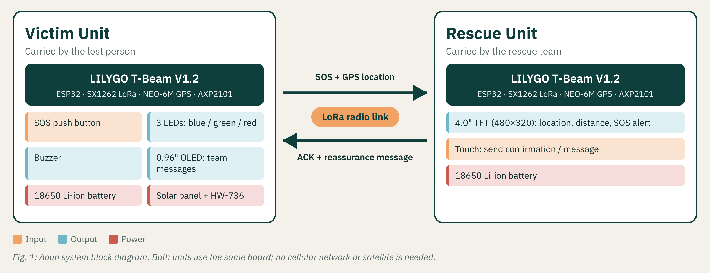
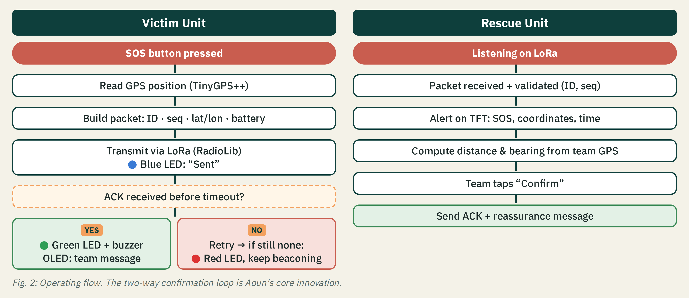
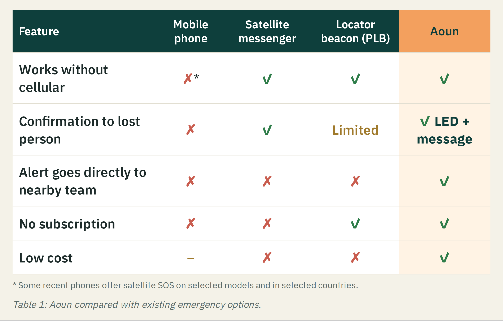

# Aoun (عون): Two-Way LoRa Distress & Tracking System

**Security & Innovation Fair (SAIF) 2026** · Smart Cities & Internet of Things (IoT) · Integrated hardware + software solution · Stage: **Proof of Concept**

> A low-cost, two-way LoRa distress and tracking system that connects lost persons to rescue teams beyond cellular coverage.

📄 **[Scientific Poster (PDF)](Aoun_SAIF_Poster.pdf)** · 📚 **[References & Evidence](REFERENCES.md)** · 🔒 **[Security Verification Report v2 (PDF)](Aoun_Security_Verification_Report.pdf)**

[English](#english) · [العربية](#arabic)

---

## Overview

Aoun is a pair of devices that communicate directly over long-range LoRa radio, with **no cellular network, internet or subscription**. Satellites are used only to receive the GPS position (free and receive-only); no message is sent through a satellite.

- **Victim unit:** one press of the SOS button sends the lost person's GPS location.
- **Rescue unit:** shows the location on a screen, and the team sends back a confirmation.

When the confirmation arrives, the victim unit turns its **green LED** on and shows a reassurance message, so the lost person knows help is coming.

## The problem

People lost in deserts, mountains and remote areas are often far from any cellular coverage, so rescue teams must search wide areas without an exact location. Existing options leave a gap: phones need coverage, satellite messengers need subscriptions, and beacons alert a distant centre while giving the sender little or no confirmation. A lost person who does not know help is coming may panic and move away from the search area.

## Our solution

| Victim-unit LED | Meaning |
|---|---|
| 🔵 Blue | SOS sent |
| 🟢 Green | Rescue team confirmed receipt |
| 🔴 Red | No response after retries, keeps beaconing |

## Security by design

| Threat | Protection |
|---|---|
| Eavesdropping on the location | AES-128-GCM encryption |
| Fake SOS or fake "help is coming" message | Authentication tag: forged or modified packets are rejected |
| Replaying an old packet | Sequence numbers |
| Unknown transmitters | Registered-device whitelist |

## Results

| Metric | Result |
|---|---|
| Security test cases passed | **10 / 10** |
| Attack types rejected (forged, modified, replayed, wrong key, unknown device) | **5 / 5** |
| Encrypted SOS packet | **37 bytes** |
| Encrypted ACK + reassurance message | **62 bytes** |
| SOS airtime, SF9 / SF12 | **≈ 0.34 s / 2.5 s** |

Security tests were run on a PC host with the same code used in the firmware, compiled against Mbed TLS 2.28 (details in the [report](Aoun_Security_Verification_Report.pdf)).

### On the real boards (2 × LILYGO T-Beam V1.2, 7 Oct 2026)

| Test | Result |
|---|---|
| Encrypted SOS received and verified by the rescue unit | ✅ |
| Encrypted confirmation verified by the victim unit | ✅ |
| Automatic retry until confirmation | ✅ |
| SOS with a wrong key | **Rejected 5 / 5** |
| SOS from an unregistered device | **Rejected 3 / 3** |
| GPS first fix (cold / warm start) | **≈ 4 min / ≈ 1 min** |
| Indoor link, incl. through a concrete floor | **All messages received in short indoor runs**, RSSI −31 to −80 dBm |

Next: field tests at 0.5 / 1 / 2 / 5 km for range, delivery rate, confirmation time and battery life with solar charging.

## Innovation

**Two-way reassurance, not just an alarm.** Aoun tells the lost person, instantly and visibly, that the nearby team received the call. It needs no network and no subscription, and it uses satellites only to receive its GPS position.

## Status

**Proof of Concept.** Both units are fully assembled in 3D-printed enclosures and run the final firmware (v1.2): encrypted two-way SOS → confirmation, live tracking every 30 s after confirmation, and an encrypted SOS cancel. Prototype build cost for both units: **1,046 SAR**. Tests so far are short indoor lab runs; open-terrain range testing is next.

**Roadmap (future work):**
1. **Range tests:** open terrain, toward 10 km+.
2. **Relay network:** units pass messages on to a gateway at base camp.
3. **Operations room:** a live map of all teams and cases (a dashboard prototype has been tested in simulation).
4. **Pilot:** with Enjad Search & Rescue Association and the Civil Defense.

Also planned: a rugged waterproof enclosure and automatic SOS on fall.

## Team

**Digital Technical College for Girls, Riyadh, Saudi Arabia**

| Name | Role |
|---|---|
| **Dana Mohammad Alanazi** | Team Leader |
| Renad Metab Aldosari | Team Member |
| Jawaher Faisal Alsharif | Team Member |
| Hailah Abdulrahman Alhejjei | Team Member |
| Abrar Hassan Alqarni | Team Member |

The source code is kept private and is available to the judging committee on request.

---

## نظرة عامة

عون جهازان يتواصلان مباشرة عبر موجات LoRa بعيدة المدى، **بدون شبكة جوال أو إنترنت أو اشتراك**. الأقمار الصناعية تُستخدم فقط لاستقبال موقع GPS (مجاناً واستقبالاً فقط)، ولا تُرسَل أي رسالة عبر قمر صناعي.

- **جهاز المفقود:** بضغطة زر SOS يرسل موقعه من الـGPS.
- **جهاز الفريق:** يعرض الموقع على الشاشة، ويرسل منه الفريق تأكيداً.

عند وصول التأكيد تضيء **اللمبة الخضراء** وتظهر رسالة طمأنة، فيعرف المفقود أن المساعدة في الطريق.

## المشكلة

التائهون في الصحارى والجبال والمناطق النائية غالباً بعيدون عن تغطية الجوال، فتبحث الفرق في مساحات واسعة بدون موقع دقيق. الحلول الحالية فيها فجوة: الجوال يحتاج تغطية، وأجهزة الأقمار الصناعية تحتاج اشتراكاً، وأجهزة تحديد الموقع ترسل التنبيه لمركز بعيد ولا تعطي المرسل تأكيداً أو تعطيه تأكيداً محدوداً. والمفقود الذي لا يعرف إن كان أحد سمع نداءه قد يهلع ويبتعد عن منطقة البحث.

## الحل

| لمبة جهاز المفقود | المعنى |
|---|---|
| 🔵 أزرق | أُرسلت الاستغاثة |
| 🟢 أخضر | الفريق أكّد الاستلام |
| 🔴 أحمر | لا استجابة بعد إعادة المحاولة، ويستمر الجهاز في الإرسال |

## الأمان

| التهديد | الحماية |
|---|---|
| التنصت على الموقع | تشفير AES-128-GCM |
| استغاثة أو تأكيد مزيف | وسم توثيق يرفض أي رسالة مزورة أو معدّلة |
| إعادة إرسال رسالة قديمة | أرقام تسلسلية |
| أجهزة غير معروفة | قائمة أجهزة معتمدة |

## النتائج

| المقياس | النتيجة |
|---|---|
| اختبارات الأمان الناجحة | **10 من 10** |
| أنواع الهجمات المرفوضة | **5 من 5** |
| حجم رسالة الاستغاثة المشفرة | **37 بايت** |
| حجم رسالة التأكيد مع رسالة الطمأنة | **62 بايت** |
| زمن إرسال الاستغاثة (SF9 / SF12) | **≈ 0.34 ثانية / 2.5 ثانية** |

**على العتاد الحقيقي (لوحتا T-Beam V1.2، 7 أكتوبر 2026):**

| الاختبار | النتيجة |
|---|---|
| استغاثة مشفّرة وصلت وتحقق منها جهاز الفريق | ✅ |
| تأكيد مشفّر وصل لجهاز المفقود وتحقق منه | ✅ |
| استغاثة بمفتاح خاطئ | **رُفضت 5 من 5** |
| استغاثة من جهاز غير مسجّل | **رُفضت 3 من 3** |
| زمن أول تحديد للموقع | **≈ 4 دقائق أول تشغيل · ≈ دقيقة بعدها** |
| الاتصال داخل المبنى، ومنها عبر سقف خرساني | **وصلت كل الرسائل في اختبارات داخلية قصيرة** |

## الابتكار

**طمأنة ثنائية الاتجاه، وليست مجرد إنذار.** عون يُعلم المفقود فوراً وبشكل مرئي أن الفريق القريب استلم نداءه، بدون شبكة أو اشتراك، ويستخدم الأقمار الصناعية فقط لاستقبال موقع GPS.

## حالة المشروع

**إثبات مفهوم:** الجهازان مجمّعان بالكامل داخل علب مطبوعة ثلاثية الأبعاد، ويعملان بالبرنامج النهائي (الإصدار 1.2): استغاثة وتأكيد مشفّران، وتتبع مباشر كل 30 ثانية بعد التأكيد، وإلغاء مشفّر للاستغاثة. تكلفة بناء الجهازين: **1,046 ريال**. الاختبارات حتى الآن داخلية وقصيرة، واختبار المدى في أرض مفتوحة هو الخطوة القادمة.

**خارطة الطريق:** (1) اختبار المدى حتى 10 كم أو أكثر · (2) شبكة ترحيل توصل الرسائل لبوابة في نقطة الانطلاق · (3) غرفة عمليات بخريطة مباشرة لكل الفرق (نموذج أولي مجرّب بالمحاكاة) · (4) تجربة فعلية مع جمعية إنجاد والدفاع المدني.

## الفريق

**الكلية التقنية الرقمية للبنات، الرياض**

| الاسم | الدور |
|---|---|
| **دنو محمد العنزي** (Dana Mohammad Alanazi) | قائدة الفريق |
| Renad Metab Aldosari | عضو الفريق |
| جواهر فيصل الشريف (Jawaher Faisal Alsharif) | عضو الفريق |
| Hailah Abdulrahman Alhejjei | عضو الفريق |
| Abrar Hassan Alqarni | عضو الفريق |

الكود المصدري محفوظ بشكل خاص، ومتاح للجنة التحكيم عند الطلب.

---

## References | المراجع

Numbers match the citations on the poster ([1]–[18]). The claim each source supports is listed in **[REFERENCES.md](REFERENCES.md)**.
الأرقام تطابق أرقام المراجع في البوستر، وتفاصيل كل مرجع في ملف REFERENCES.md.

1. AMSA, *How distress beacons work*. https://beacons.amsa.gov.au/about/how-they-work.asp
2. European GNSS Service Centre, *SAR/Galileo Return Link Service*. https://www.gsc-europa.eu/node/5876
3. KSL, *Hiking safety: what to do if you get lost* (interview with a search and rescue coordinator). https://www.ksl.com/article/36147671/hiking-safety-what-to-do-if-you-get-lost · Trail Hiking Australia, *What to do if you get lost hiking*. https://www.trailhiking.com.au/hike-safety/getting-lost/
4. Garmin, *inReach satellite communication: subscription plans*. https://www.garmin.com.my/minisite/inreach/personal/
5. MacRumors, *Apple's free satellite features on iPhone: available countries* (Oct 2025). https://www.macrumors.com/2025/10/10/apple-satellite-features-which-countries/
6. GPS.gov, *Free access for civilian use*. https://www.gps.gov/node/34
7. Semtech LoRa overview (via Richardson RFPD). https://www.richardsonrfpd.com/?p=13261
8. Communications, Space & Technology Commission (CST), *RI054 Specification for Short Range Devices*. https://www.cst.gov.sa/ar/RulesandSystems/RegulatoryDocuments/EquipmentApproval/Documents/TA%20959%20E%20RI054.pdf
9. Semtech, *SX1262 product page*. https://www.semtech.com/products/wireless-rf/lora-transceivers/sx1262
10. u-blox, *NEO-6 GPS Modules Data Sheet* (GPS.G6-HW-09005). https://www.u-blox.com/sites/default/files/products/documents/NEO-6_DataSheet_%28GPS.G6-HW-09005%29.pdf
11. NIST SP 800-38D, *Galois/Counter Mode (GCM) and GMAC*. https://csrc.nist.gov/pubs/sp/800/38/d/final
12. LILYGO, *T-Beam* product page (US$40.98). https://lilygo.cc/products/t-beam-softrf
13. ACR ResQLink 410 RLS listing (US$429.95). https://freeportmarine.com/products/acr-resqlink-410-rls
14. Al-Watan, *131 مفقودا في الصحارى* (7 Apr 2021). https://www.alwatan.com.sa/article/1073200
15. Al-Watan, *128 بلاغا يوميا لمركبات عالقة* (7 Apr 2025). https://www.alwatan.com.sa/ampArticle/1163298
16. Our security test report: [Aoun_Security_Verification_Report.pdf](Aoun_Security_Verification_Report.pdf)
17. Our on-device lab tests, ["On the real boards" on this page](#on-the-real-boards-2--lilygo-t-beam-v12-7-oct-2026)
18. GPS.gov, *Space Segment*. https://www.gps.gov/systems/gps/space · GPS.gov, *Constellation arrangement*. https://www.gps.gov/node/198

**Open-source libraries used | المكتبات مفتوحة المصدر:** [RadioLib](https://github.com/jgromes/RadioLib) · [TinyGPS++](https://github.com/mikalhart/TinyGPSPlus) · [XPowersLib](https://github.com/lewisxhe/XPowersLib) · [TFT_eSPI](https://github.com/Bodmer/TFT_eSPI) · [Adafruit SSD1306](https://github.com/adafruit/Adafruit_SSD1306) · [Mbed TLS](https://github.com/Mbed-TLS/mbedtls) · [LILYGO T-Beam](https://github.com/Xinyuan-LilyGO/LilyGo-LoRa-Series)

© 2026 Team Aoun, Digital Technical College for Girls. All rights reserved.
